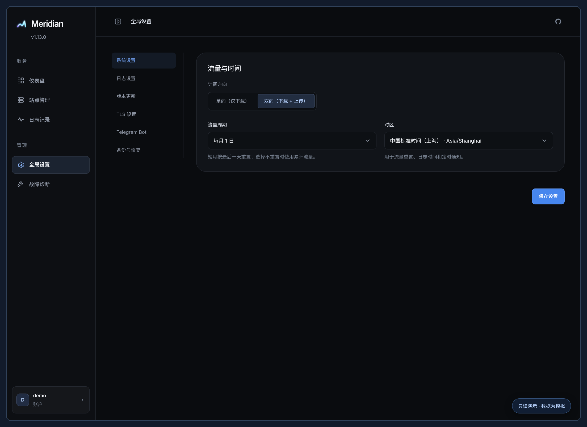

# 部署指南

[返回首页](../README.md) · [完整 Wiki](https://github.com/snnabb/Meridian/wiki) · [使用指南](USAGE.md) · [安全说明](../SECURITY.md)

## 一键安装

```bash
bash <(curl -fsSL https://raw.githubusercontent.com/snnabb/Meridian/master/install.sh)
```

交互菜单提供安装、更新、修改管理员密码、卸载和泛域名证书配置。首次安装默认端口 `9090`，已有安装保留当前端口。Linux systemd 使用独立非 root 账户；macOS 支持安装，但不自动配置域名。

```bash
# 配置面板域名与 HTTPS
bash <(curl -fsSL https://raw.githubusercontent.com/snnabb/Meridian/master/install.sh) install \
  --port 9090 --domain panel.example.com --email admin@example.com -y

# 更新：校验下载、备份、健康检查，失败回滚
bash <(curl -fsSL https://raw.githubusercontent.com/snnabb/Meridian/master/install.sh) update

# 重置管理员密码
bash <(curl -fsSL https://raw.githubusercontent.com/snnabb/Meridian/master/install.sh) password

# 卸载并保留数据；只有 --purge 才删除数据
bash <(curl -fsSL https://raw.githubusercontent.com/snnabb/Meridian/master/install.sh) uninstall
```

未配置域名时只监听 `127.0.0.1`。域名流程可配置 Nginx 与 HTTPS；安装器仅管理自己的面板代理，不修改站点回源或其他 Nginx 站点。安装完成后，使用显示的初始化令牌创建管理员，密码至少 6 个字符、最多 72 个 UTF-8 字节。

`SETUP_TOKEN` 赋予首次创建管理员的权限，保存在权限受限的 `/opt/meridian/.env`，新生成时只显示一次。不要放进截图、日志或公开 Issue。安装器生成的长期密钥应与数据库一起备份。

### 泛域名证书

安装菜单可配置 Cloudflare DNS-01 泛域名证书，也可下载脚本后执行：

```bash
curl -fsSL https://raw.githubusercontent.com/snnabb/Meridian/master/install.sh -o install.sh
bash install.sh tls --domain panel.example.com --wildcard '*.example.com' \
  --email admin@example.com --port 9090 --dns-token-file /root/cloudflare-token -y
```

Token 文件需限制为仅管理员可读，并授予目标 Zone 的 Zone Read、DNS Edit 权限。也可通过交互式隐藏输入提供 Token；不要将 Token 放进命令行参数。

此流程配置原生 HTTPS 与自动续期，失败回滚数据库、环境和证书；成功后移除安装器管理的旧面板 Nginx 配置，其他站点保留。放行实际端口，并检查 CDN 的支持范围。也可在面板内申请或导入证书，见 [TLS 说明](USAGE.md#tls-证书)。

## Docker Compose

创建目录与持久密钥；这一步只在首次部署时执行：

```bash
mkdir meridian && cd meridian
umask 077
for key in JWT_SECRET UPSTREAM_HEADER_KEY DYNAMIC_ROUTE_KEY MERIDIAN_SECRET_KEY SETUP_TOKEN; do
  printf '%s=%s\n' "$key" "$(openssl rand -hex 32)"
done > .env
chmod 600 .env
```

创建 `compose.yaml`：

```yaml
services:
  meridian:
    image: ghcr.io/snnabb/meridian:latest
    user: "10001:10001"
    restart: unless-stopped
    read_only: true
    cap_drop:
      - ALL
    cap_add:
      - NET_BIND_SERVICE
    security_opt:
      - no-new-privileges:true
    tmpfs:
      - /tmp:rw,noexec,nosuid,size=16m
    ulimits:
      nofile:
        soft: 65536
        hard: 65536
    ports:
      - "127.0.0.1:9090:9090"
      # 使用独立站点端口时按需添加映射，例如 "8001:8001"
    volumes:
      - meridian-data:/app/data
    env_file:
      - .env
    environment:
      PANEL_BIND_ADDR: 0.0.0.0
      ALLOW_INSECURE_HTTP: "true"

volumes:
  meridian-data:
```

```bash
docker compose up -d
# 更新
docker compose pull && docker compose up -d
```

通过 HTTPS 反向代理连接本机 `127.0.0.1:9090`，首次初始化令牌从 `.env` 的 `SETUP_TOKEN` 获取。上面的 HTTP 设置只用于容器内部这一跳，宿主机端口仍限制在回环地址。

示例使用官方镜像初始化的命名卷，以 `10001:10001` 运行。官方程序带有端口绑定文件能力，需要保留 `NET_BIND_SERVICE` 能力边界；使用宿主目录时，先确保该目录可由服务 UID/GID 读写。

设置 `PANEL_DOMAIN` 为面板域名。`v1.13.5` 起，环境管理的域名在每次启动同步，修改、移除或置空后用 `docker compose up -d` 重建容器；面板手动保存域名或配置原生证书后，以数据库为准。需要使用转发头时，将 `TRUSTED_PROXY_CIDRS` 精确设为实际反向代理地址或网段。备份 `.env` 和数据卷，重建容器时继续使用原密钥。

## Windows 与源码

从 [Releases](https://github.com/snnabb/Meridian/releases/latest) 下载对应系统的程序。通过受保护的系统配置持久保存下表中的四个独立长期密钥及首次初始化令牌，然后运行：

```bash
./meridian --port 9090 --db /data/meridian.db
```

Windows 使用 `meridian-windows-amd64.exe`，数据库路径按实际目录填写，并通过 Windows ACL 限制数据目录权限。

源码构建需要 Go 1.26.9 或更高版本，无需 Node 或前端构建：

```bash
git clone https://github.com/snnabb/Meridian.git
cd Meridian
go build -trimpath -buildvcs=false -o meridian ./cmd/meridian
```

## 关键配置

| 变量 | 用途 |
| --- | --- |
| `PORT` / `DB_PATH` | 默认 `9090` / `meridian.db` |
| `PANEL_BIND_ADDR` | 默认 `127.0.0.1` |
| `PANEL_DOMAIN` | 面板允许的域名 |
| `TRUSTED_PROXY_CIDRS` | 可信反向代理的精确 CIDR，逗号分隔 |
| `JWT_SECRET` | 会话签名，至少 32 字节 |
| `UPSTREAM_HEADER_KEY` | 固定回源 Header 加密，至少 32 字节 |
| `DYNAMIC_ROUTE_KEY` | 动态播放路由签发，至少 32 字节 |
| `MERIDIAN_SECRET_KEY` | Cloudflare / Telegram 凭据加密，至少 32 字节 |
| `SETUP_TOKEN` | 首次初始化凭据 |

四个长期密钥必须互不相同且持久保存。丢失加密密钥会导致对应凭据无法解密，重置会话密钥会使已有登录失效。一键安装器会维护这些配置。



## 离线恢复账户

systemd 部署优先使用安装器的 `password` 操作。其他部署先停止服务，再通过标准输入重置密码：

```bash
read -r -s -p '新密码: ' MERIDIAN_ADMIN_PASSWORD; echo
printf '%s\n' "$MERIDIAN_ADMIN_PASSWORD" | ./meridian admin reset-password \
  --db /data/meridian.db --password-stdin
unset MERIDIAN_ADMIN_PASSWORD
```

数据库必须已有且仅有一个管理员。操作前备份数据库与持久密钥，完成后启动服务。
