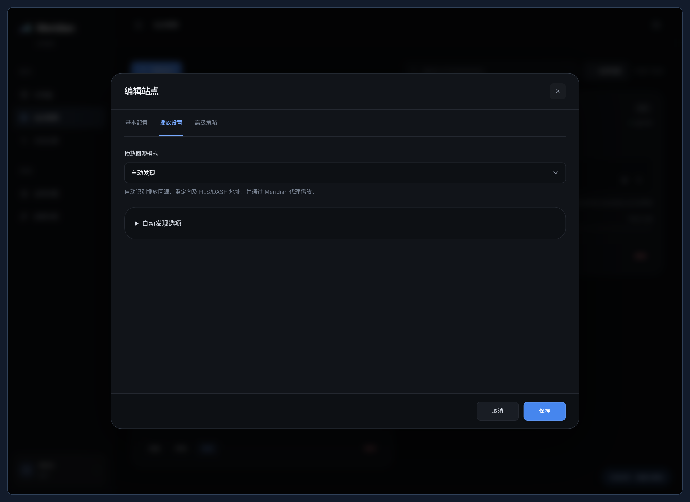
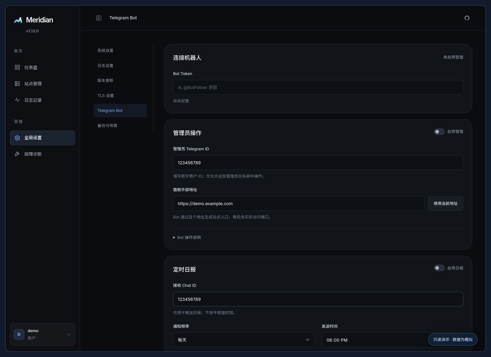
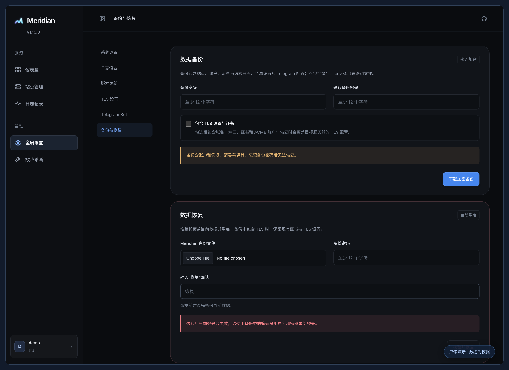

# 使用指南

[返回首页](../README.md) · [完整 Wiki](https://snnabb.github.io/Meridian/) · [部署文档](DEPLOYMENT.md)

## 站点与播放

新建站点默认使用路径入口，例如 `https://panel.example.com/cinema/`。也可使用独立端口或子域名。子域名入口需要配置域名与相应证书；独立端口需要放行防火墙，并确认前置 CDN 支持该端口。

主地址按协议、地址、端口填写，也支持粘贴完整 URL 自动拆分。HTTP 默认 `8096`，HTTPS 默认 `443`；已有站点保留原端口。最多配置 7 条备用线路，按顺序切换并支持恢复回切。

| 播放模式 | 行为 |
| --- | --- |
| 自动发现 | 识别重定向、PlaybackInfo、HLS/DASH 中的媒体后端，通过 Meridian 代理；默认使用 Compatible 策略。 |
| 手动填写 | 使用指定的播放回源与额外节点；留空时沿用主地址。 |
| 直连播放 | 客户端直接访问视频、清单与分片；登录、海报、字幕和普通 API 继续代理。 |

直连要求客户端能访问媒体源，直连媒体流量不经过 Meridian。不同媒体服务和客户端的要求可能不同，连接检测通过不代表完整播放链路已验证。

高级设置包含 UA 预设、自定义或透传、固定上游请求头、客户端 IP、限速、配额和缓存。固定 Header 加密保存，仅发送到主回源的精确协议、域名与端口，不随跨域跳转传播。

自动发现提供 Safe、Compatible、Extreme 预设。Safe 只接受公网 DNS 域名的 HTTPS:443，空规则允许符合网络校验的公网 DNS 域名，添加规则可进一步收窄；Compatible 支持公网 HTTP(S)、有效端口与标准 HLS/DASH；Extreme 用于需要扩展结构兼容的场景。详细网络边界见 [SECURITY.md](../SECURITY.md)。

## 流量、日志与诊断

- 默认按客户端上传与返回客户端的代理载荷合计，即“入站 + 出站”，也可切换为“仅出站”。配额、趋势与 Telegram 报告使用相同口径。
- 全局设置可调整月度重置日与 IANA 时区。累计流量和当期用量分别显示。
- 日志支持站点、日期、资源类别、状态和关键词筛选；可配置保存期限及写入、展示字段。日志不保存查询参数、令牌、Cookie 或正文。
- 故障诊断位于侧边栏，可检查主回源、播放回源、备用线路、TLS 和客户端标识。

## TLS 证书

在“全局设置 → TLS 设置”填写完整面板域名、监听端口和可选节点泛域名，再选择证书来源。

| 来源 | 配置与续期 |
| --- | --- |
| Cloudflare 自动申请 | 填写 ACME 邮箱与目标 Zone 的 API Token；需要 Zone Read、DNS Edit 权限。通过 DNS-01 签发，Meridian 自动检查续期。 |
| 服务器文件路径 | 填写完整证书链与未加密私钥的绝对路径，服务账户须能读取；文件变化每分钟检查并热重载。 |
| 上传证书 | 上传 PEM 证书链与未加密私钥，续期后需重新上传。 |

证书必须覆盖面板域名；配置节点泛域名时还需包含对应通配符。导入会校验格式、配对、有效期与域名，失败时保留现有证书。变更监听端口或 TLS 状态后，按页面提示重启。

经 Nginx 等反向代理访问时，页面显示的公开端口与 Meridian 内部端口可能不同；修改内部监听配置时，需要同步调整反向代理。

## Telegram Bot

1. 从 [@BotFather](https://t.me/BotFather) 创建 Bot，将 Token 填入“全局设置 → Telegram Bot”。
2. 填写管理员的数字用户 ID，多个 ID 用逗号分隔，最多 10 个。不能使用群组 ID。
3. 填写真实面板外部地址，包含实际端口，例如 `https://panel.example.com:8443`。
4. 启用管理，保存后向 Bot 私聊发送 `/start`。

启用时自动替换为 Meridian 命令菜单。按钮导航与分步输入更新当前消息；`/start` 重新打开面板，`/menu` 返回当前面板主菜单。

| 命令 | 操作 |
| --- | --- |
| `/start`、`/menu` | 打开或返回管理菜单 |
| `/sites`、`/add` | 管理已有站点或分步添加 |
| `/address`、`/traffic` | 查看站点入口或流量 |
| `/report`、`/status` | 查看即时日报或运行概览 |
| `/cancel`、`/help`、`/id` | 取消操作、帮助、当前用户 ID |

可编辑名称、主地址、入口、播放模式、配额、限速、缓存、备用线路和客户端标识。修改前显示摘要，确认按钮 10 分钟有效且只执行一次；遇到其他管理员或面板的配置变更时需要重新选择。

定时日报与管理分别开关。日报接收 Chat ID 可以是个人、群组或频道，但不会获得管理权限。管理指令仅接受白名单管理员私聊。同一个 Token 只能交给一个长轮询接收程序，无需开放 Webhook 端口；连接错误会显示在设置页。

## 更新与备份

“版本更新”检查 GitHub 最新正式版本。标准 Linux systemd 安装支持面板内更新，并执行下载校验、备份、健康检查与失败回滚。已有标准安装可以再次运行新版安装器的 `install -y` 补装更新服务。Docker、手工或自定义目录部署按原方式更新。

“备份与恢复”导出密码保护的备份，包含站点、账户、流量、日志、全局设置与 Telegram 配置。TLS 数据需单独勾选；不包含环境文件和独立部署密钥文件，加密包内部包含迁移已加密凭据所需密钥材料，仍应另行保存部署配置。备份密码至少 12 个字符，忘记后无法恢复。

恢复会覆盖当前数据并重启，需要使用备份中的账户重新登录。未勾选 TLS 的备份保留目标服务器 TLS 配置；路径来源的证书恢复为上传副本，不引用原服务器路径。

